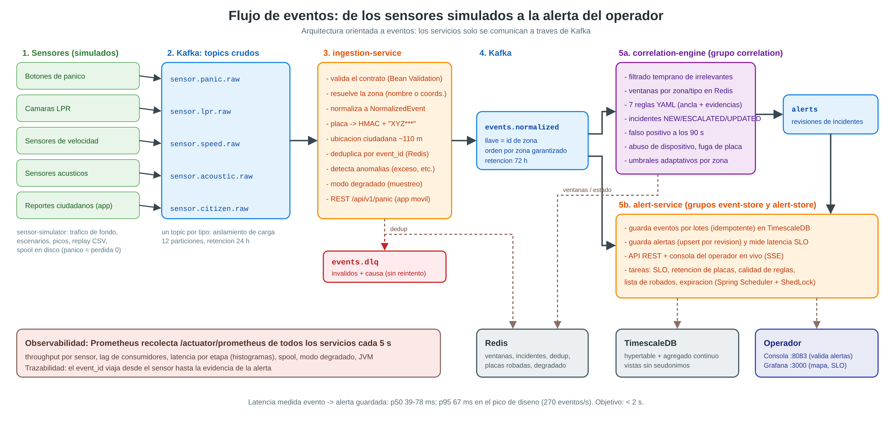

# Centinela Urbano

**Simulación de un sistema de monitoreo perimetral urbano con detección, procesamiento, correlación y
visualización de eventos críticos.**
Proyecto final de Arquitectura de Computadores II, Universidad Mariano Gálvez de Guatemala, 2026.

Microservicios orientados a eventos en **Java 21 + Spring Boot 3.5**, sobre **Apache Kafka**,
**TimescaleDB**, **Redis**, **Prometheus** y **Grafana**, desplegables en una sola máquina o
repartidos en varias (nodos A, B y C/D).



## Qué hace

1. **Simula cinco tipos de sensores urbanos** (sección 2.1 del enunciado): botones de pánico, cámaras
   LPR, sensores de velocidad, sensores acústicos y reportes ciudadanos. Incluye tráfico de fondo
   realista, 10 escenarios (entre ellos el ejemplo exacto de la tabla 2.4), picos de carga y replay
   CSV con aleatorización.
2. **Ingiere** los eventos: los valida, los normaliza a un modelo común, **seudonimiza las placas con
   HMAC**, deduplica y envía los inválidos a una DLQ.
3. **Correlaciona** fuentes heterogéneas por zona y ventana de tiempo con un motor de evidencia
   ponderada. Por ejemplo: pánico + exceso de velocidad + placa a alta velocidad = robo en curso
   CRITICAL. Un pánico sin corroborar = posible falso positivo. También sigue vehículos en fuga entre
   zonas y detecta dispositivos abusivos.
4. **Alerta y visualiza:** consola del operador en vivo para validar alertas, más 3 dashboards de
   Grafana (mapa de calor, SLO y salud, análisis de falsos positivos).
5. **Se protege solo:** SLO de latencia de 2 s con degradación controlada automática, buffer en disco
   para eventos críticos, reintentos y tareas periódicas de retención y calidad.

## Resultados clave

| Métrica | Resultado |
|---|---|
| Correlaciones esperadas detectadas | **9 de 9** (en una sola máquina y en multi-nodo) |
| Latencia evento → alerta, pico de diseño de 270 eventos/s | **p50 = 39 ms, p95 = 67 ms** (objetivo < 2 s) |
| Eventos críticos perdidos durante una caída de Kafka | **0** |
| Reparto de carga entre máquinas | 6 + 6 particiones; failover en segundos |
| Pruebas automatizadas | 26 (15 del motor de correlación) |

## Arranque rápido

```bash
cp .env.example .env
docker compose up -d --build
```

- Consola del operador: http://localhost:8083 (operador / operador123)
- Grafana: http://localhost:3000 (admin / admin123)
- Validación automática: `curl -X POST localhost:8080/api/validation` y luego
  `curl localhost:8080/api/validation/latest`

Despliegue en varias máquinas: [`deploy/README.md`](deploy/README.md).

## Estructura

```
common/              contratos de eventos, zonas, seudonimización (librería)
sensor-simulator/    simulador de sensores, escenarios, validación automática
ingestion-service/   validación, normalización, privacidad, DLQ, gateway REST
correlation-engine/  motor de correlación (reglas en application.yml)
alert-service/       persistencia, API, consola, tareas periódicas, migraciones Flyway
infra/               Prometheus y Grafana (datasources y dashboards como código)
deploy/              docker compose por nodo (A datos, B servicios, C/D generadores + workers)
docs/                arquitectura, ADRs, correlación, manual, resultados, guía de estudio
informe/             informe final y anexo de ADRs en Word (formato APA 7)
```

## Documentación (entregables de la sección 8)

| Entregable | Dónde |
|---|---|
| Diseño de infraestructura (nodos, servicios, segmentos de red) | [`docs/arquitectura.md`](docs/arquitectura.md), [`docs/img/infraestructura.png`](docs/img/infraestructura.png) |
| Architecture Decision Records (10) | [`docs/adr/`](docs/adr/README.md) y `informe/Anexo-A-ADRs.docx` |
| Configuración técnica de servicios y contenedores | `docker-compose.yml`, `deploy/`, `Dockerfile`, `*/src/main/resources/application.yml` |
| Scripts de simulación de eventos | `sensor-simulator/` (escenarios, replay CSV en `src/main/resources/replay/`) |
| Sistema de correlación e inferencia | [`docs/correlacion.md`](docs/correlacion.md) |
| Visualización en Grafana | `infra/grafana/dashboards/` |
| Informe final académico | `informe/Informe-Final-Centinela-Urbano.docx` |
| Manual de operación y guion de la demo | [`docs/manual-operacion.md`](docs/manual-operacion.md) |
| Evaluación de resultados | [`docs/resultados.md`](docs/resultados.md) |
| Guía de estudio para la defensa | [`docs/guia-de-estudio.md`](docs/guia-de-estudio.md) |
