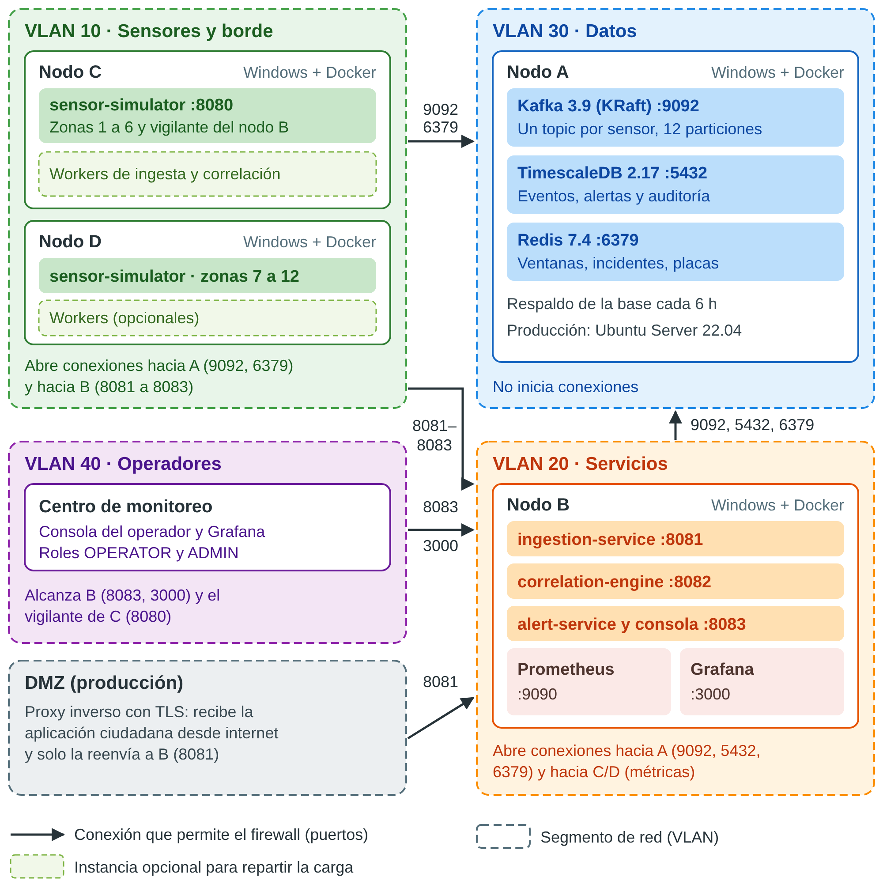

# Arquitectura de Centinela Urbano

## 1. Visión general

Centinela Urbano simula un sistema de monitoreo perimetral urbano para una **municipalidad de tamaño
medio**: 12 zonas, unos 500 000 habitantes y despliegue on-premise ([ADR-001](adr/ADR-001-plataforma-de-despliegue.md)).
Recibe eventos de cinco tipos de sensores simulados, los valida y anonimiza, los correlaciona en
tiempo real para inferir incidentes y los muestra a los operadores en una consola en vivo y en Grafana.

Estilo: **microservicios orientados a eventos** ([ADR-010](adr/ADR-010-estilo-arquitectonico-y-stack.md)).
Los servicios no se llaman entre sí: se comunican publicando y consumiendo eventos en Kafka. Así cada
uno escala y falla de forma independiente.


## 2. Componentes

| Componente | Tecnología | Nodo | Responsabilidad |
|---|---|---|---|
| sensor-simulator | Java 21, Spring Boot 3.5 | C/D | Emula los 5 sensores; escenarios, picos, replay CSV, validación automática; spool *write-ahead* en disco y **vigilante** del nodo B |
| ingestion-service | Java 21, Spring Boot, Spring Kafka | B (+ workers en C/D) | Validación, normalización, seudonimización, deduplicación, DLQ, gateway REST con spool en disco |
| correlation-engine | Java 21, Spring Boot, Redis | B (+ workers en C/D) | Reglas de evidencia ponderada, incidentes, falsos positivos, seguimiento de placas |
| alert-service | Java 21, Spring Boot, Spring Security, Flyway, ShedLock | B | Persistencia, API REST + SSE, consola del operador, tareas periódicas (SLO, lista de placas, reproceso de la DLQ) |
| Apache Kafka 3.9 (KRaft) | Broker de eventos | A | Transporte desacoplado y persistente ([ADR-002](adr/ADR-002-broker-de-eventos.md)) |
| TimescaleDB 2.17 (PG 16) | Base de series de tiempo y relacional | A | Eventos, alertas, auditoría, SLO ([ADR-003](adr/ADR-003-persistencia-de-eventos.md)) |
| Redis 7.4 | Almacén en memoria | A | Ventanas de correlación, incidentes, deduplicación, lista de placas, bandera de degradación |
| db-backup | `pg_dump` en un contenedor | A | Respaldo de la base cada 6 h (se guardan 8) y restauración con un comando |
| Prometheus 3.1 | Métricas | B | Métricas técnicas de los servicios ([ADR-008](adr/ADR-008-observabilidad-y-slos.md)) |
| Grafana 11.4 | Visualización | B | 3 dashboards provisionados |

## 3. Infraestructura y segmentos de red



| Nodo | Función | SO | Composición |
|---|---|---|---|
| A | Datos | Windows 10/11 + Docker Desktop | `deploy/nodo-a/docker-compose.yml` |
| B | Microservicios y visualización | Windows 10/11 + Docker Desktop | `deploy/nodo-b/docker-compose.yml` |
| C / D | Generación de eventos + workers | Windows 10/11 + Docker Desktop | `deploy/nodo-c/docker-compose.yml` |

Todas las PCs del laboratorio son Windows: cada nodo se configura y se levanta con `centinela.cmd`
(`configurar -Nodo A`, `firewall`, `iniciar`), que llama a Docker Compose con el archivo del nodo. Los
contenedores son Linux, pero Docker Desktop los ejecuta por su cuenta; nadie tiene que usar Linux. En
producción el nodo A iría preferentemente en Linux de servidor ([ADR-005](adr/ADR-005-contenerizacion-y-orquestacion.md)),
sin cambiar nada de los composes.

Reglas de red: ver [ADR-007](adr/ADR-007-seguridad-y-privacidad-de-datos.md) y la guía [`deploy/README.md`](../deploy/README.md).

## 4. Contratos de eventos

Los contratos crudos usan **exactamente los campos de la sección 2.1 del enunciado** en el JSON (en
español), definidos como `record` de Java en `common/src/main/java/gt/umg/centinela/common/model/raw/`.

| Sensor | Topic | Campos (JSON) |
|---|---|---|
| Botón de pánico | `sensor.panic.raw` | `event_id`, `timestamp`, `zona_geografica` {nombre, latitud, longitud}, `tipo_alerta` (PANICO, ROBO, ASALTO, EMERGENCIA_MEDICA, INCENDIO, ACCIDENTE), `identificador_dispositivo`, `user_context` {usuario_id, plataforma, version_app} |
| Cámara LPR | `sensor.lpr.raw` | `event_id`, `timestamp`, `placa_vehicular`, `ubicacion_sensor` {sensor_id, zona, latitud, longitud}, `velocidad_estimada`, `modelo_vehiculo`, `color_vehiculo` |
| Velocidad | `sensor.speed.raw` | `event_id`, `timestamp`, `sensor_id`, `zona`, `velocidad_detectada`, `direccion` (NORTE/SUR/ESTE/OESTE), `contravia`, `limite_velocidad` |
| Acústico | `sensor.acoustic.raw` | `event_id`, `timestamp`, `sensor_id`, `zona`, `tipo_sonido_detectado` (DISPARO, EXPLOSION, VIDRIOS_ROTOS, CHOQUE_VEHICULAR, RUIDO_AMBIENTAL), `nivel_decibeles`, `probabilidad_evento_critico` |
| Reporte ciudadano | `sensor.citizen.raw` | `event_id`, `timestamp`, `tipo_evento` (ACCIDENTE, INCENDIO, ALTERCADO, ROBO, PERSONA_SOSPECHOSA, OTRO), `mensaje_descriptivo`, `ubicacion_aproximada` {latitud, longitud}, `origen` (USUARIO, APP, PUNTO_FISICO), `reportante_id` |

Ejemplo de un botón de pánico crudo:

```json
{
  "event_id": "7c9e6679-7425-40de-944b-e07fc1f90ae7",
  "timestamp": "2026-10-30T04:05:00Z",
  "zona_geografica": { "nombre": "Zona 4", "latitud": 14.6402, "longitud": -90.5011 },
  "tipo_alerta": "ROBO",
  "identificador_dispositivo": "APP-04512",
  "user_context": { "usuario_id": "CIU-04512", "plataforma": "ANDROID", "version_app": "2.3.1" }
}
```

La ingesta convierte los cinco contratos a un formato común, `NormalizedEvent` (`events.normalized`,
llave = zona):

```json
{
  "eventId": "7c9e6679-...", "sensorType": "PANIC", "sensorId": "APP-3f9a1c2b7d10",
  "zoneId": 4, "zoneName": "Zona 4", "latitude": 14.64, "longitude": -90.501,
  "eventTime": "2026-10-30T04:05:00Z", "ingestedAt": "2026-10-30T04:05:00.012Z",
  "subtype": "ROBO", "value": null, "confidence": 1.0, "anomalous": true,
  "plateHash": null, "plateMasked": null, "sourceHash": "a91f...", "origin": "APP",
  "attributes": { "plataforma": "ANDROID", "version_app": "2.3.1" }
}
```

Datos heterogéneos y no estructurados, como el texto libre o las coordenadas sin nombre de zona, se
convierten a un modelo homogéneo:
- la zona se resuelve por nombre ("Zona 4", "Z4", "4") o por coordenadas, con un geocercado al
  centroide más cercano;
- las anomalías se calculan por sensor: velocidad mayor al 130 % del límite, sonido crítico con
  probabilidad ≥ 0,5, etc.

## 5. Modelo de datos (TimescaleDB)

| Tabla / vista | Tipo | Contenido |
|---|---|---|
| `sensor_events` | Hypertable (particiones diarias, compresión a 45 d, retención 90 d) | Todos los eventos normalizados |
| `events_per_minute` | Agregado continuo (tiempo real) | Conteos por minuto, zona y tipo |
| `alerts` | Tabla | Estado actual de cada incidente (upsert por revisión) |
| `alert_revisions` | Tabla | Historial de revisiones con latencia (base del SLO) |
| `audit_log` | Tabla | Validaciones, cambios en la lista de placas, purgas, reinicios |
| `plate_watchlist` | Tabla | Seudónimos de placas robadas |
| `slo_measurements` | Tabla | Mediciones de SLO cada 30 s, con la causa de cada incumplimiento (sobrecarga o recuperación) y el atraso de Kafka |
| `rule_quality` | Tabla | Precisión por regla y zona, y ajuste de umbral |
| `shedlock` | Tabla | Bloqueos de las tareas periódicas |
| `v_events`, `v_alerts` | Vistas | Lo que ve Grafana: **sin seudónimos** |

Esquema completo: `alert-service/src/main/resources/db/migration/`.

## 6. Decisiones de arquitectura

Las diez decisiones relevantes están en [`docs/adr/`](adr/README.md).

## 7. Correlación e inferencia

Ver [`correlacion.md`](correlacion.md).

## 8. Tolerancia a fallos

El diseño separa el **estado** (nodo A: Kafka, TimescaleDB, Redis) del **cómputo** (nodo B y workers
en C/D). Resumen de lo que ocurre ante cada falla (detalle y mediciones en
[ADR-006](adr/ADR-006-resiliencia-y-tolerancia-a-fallos.md) y [`resultados.md`](resultados.md)):

| Falla | Qué hace el sistema | Qué se pierde |
|---|---|---|
| Cae el nodo B | Los workers de C siguen detectando; Kafka guarda lo demás. El **vigilante** de C lo anuncia en ~16 s y la consola avisa "sin conexión"; al volver, recupera y destaca lo perdido | Nada: solo retraso |
| Cae el nodo A | El simulador escribe en disco por adelantado (*write-ahead*) los críticos y guarda la telemetría útil (últimos 15 min) si el envío falla; el gateway de la app guarda en disco con `fsync` lo que Kafka no confirma en 3 s (responde 202 solo cuando el evento ya es durable). Todo se reenvía al volver. La lista de placas se recarga sola en ~20 s | Lecturas de velocidad normales, ruido ambiental y la memoria de corto plazo de Redis |
| Redis o la base caen unos minutos | Reintentos sin límite con espera exponencial (tope 30 s); nada de eso va a la DLQ | Nada |
| Mensaje inválido | DLQ inmediata con la clase de falla; el resto del flujo sigue | Ese mensaje queda apartado para análisis |
| Muere un proceso a mitad de una alerta | Alertas con ID determinista y persistencia idempotente: el reproceso produce la misma alerta, sin duplicarla | Nada |
