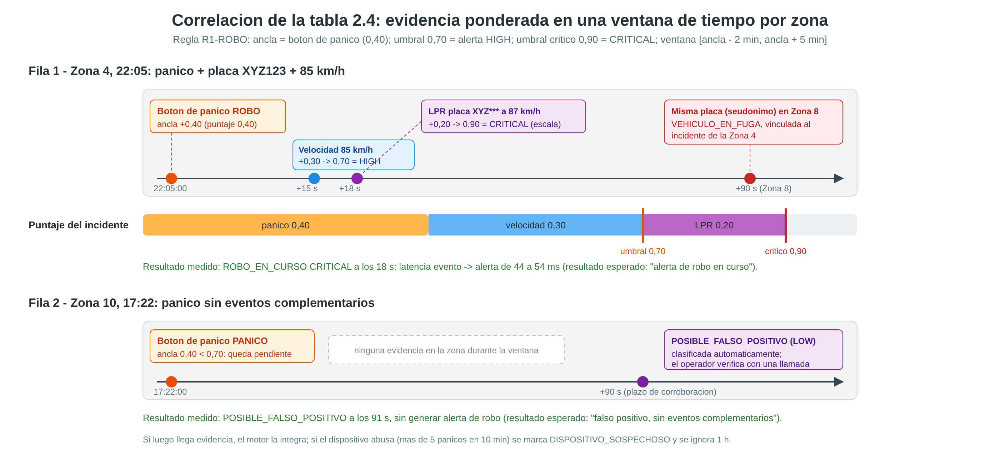

# Sistema de correlación e inferencia de eventos

Este documento corresponde al entregable *"Documentación del sistema de correlación e inferencia"* y
se complementa con el [ADR-009](adr/ADR-009-modelo-de-correlacion.md), que justifica el enfoque
elegido.



## 1. Idea general

Un evento aislado casi nunca basta para concluir algo:
- un botón de pánico puede ser un error;
- un exceso de velocidad pasa todos los días;
- un "disparo" acústico puede ser un cohete.

Varios eventos **de fuentes distintas, en la misma zona y en una ventana de tiempo corta**, sí
permiten inferir un incidente con confianza. Eso es correlacionar.

El motor usa **reglas de evidencia ponderada**:

```
puntaje = peso del ANCLA + Σ peso de cada EVIDENCIA encontrada      (máximo 1,0)

si puntaje ≥ umbral          → se genera la alerta con la severidad base de la regla (HIGH)
si puntaje ≥ umbral crítico  → la severidad sube a CRITICAL
```

- **Ancla:** el evento que inicia la sospecha, por ejemplo un botón de pánico de tipo ROBO.
- **Evidencia:** otro evento que la refuerza si ocurre en la **misma zona** dentro de la ventana
  `[ancla − antes, ancla + después]`.
- **Fuentes distintas:** dentro de una misma evidencia, cada persona o sensor cuenta una sola vez.
  Así, quien presionó el botón no puede corroborarse a sí mismo enviando además un reporte.

## 2. Flujo de procesamiento de cada evento

1. Llega un evento normalizado desde `events.normalized`. La llave es la zona, así que los eventos de
   una zona llegan en orden a la misma instancia.
2. **Abuso de dispositivo** (solo botones de pánico): si el mismo dispositivo supera 5 pánicos en 10
   minutos, se emite `DISPOSITIVO_SOSPECHOSO` y sus pánicos se ignoran durante 1 hora.
3. **Seguimiento de placas** (solo LPR): si la placa, ya seudonimizada, pertenece a un vehículo
   sospechoso de un incidente reciente y aparece en **otra zona**, se emite `VEHICULO_EN_FUGA`.
4. **Filtrado temprano:** si el evento no cumple ninguna condición de ninguna regla (lectura de
   velocidad normal, placa sin novedad, ruido ambiental), termina aquí. Esto descarta ≈ 99 % de la
   telemetría y es lo que permite procesar picos de cientos de eventos por segundo.
5. Se guarda en la **ventana de Redis** de su zona y tipo (*sorted set*, con la hora del evento como
   puntaje).
6. Para cada regla en la que participa:
   - **como ancla:** se calcula su puntaje con la evidencia que ya existe en la ventana;
   - **como evidencia:** se buscan las anclas de esa regla en la zona cuya ventana lo contiene y se
     recalcula el puntaje de cada una.

   Como se evalúa en ambos sentidos, **no importa el orden de llegada**: la evidencia puede llegar
   antes o después del ancla.
7. Las coincidencias que alcanzan el umbral se prueban de mayor a menor puntaje, y la primera que
   aporta algo **abre o actualiza el incidente** (a lo sumo una alerta o revisión por evento):
   - **NEW:** primera vez de ese tipo en esa zona (en los últimos 10 minutos).
   - **ESCALATED:** el incidente ya existía y subió de severidad o apareció una placa sospechosa.
   - **UPDATED:** se sumó un nuevo testigo o ancla, como otro botón de pánico.
   - Nada nuevo: se prueba la coincidencia siguiente; si ninguna aporta, no se emite nada (se
     evitan duplicados). Probar solo la mejor era un defecto, encontrado al grabar el video: un
     segundo robo 2 a 5 minutos después del primero perdía frente a la coincidencia del primer pánico
     (que ya estaba en el incidente) y su revisión salía recién a los 90 s, al vencer el plazo de
     falso positivo.
8. Si un ancla con verificación de falso positivo no alcanza el umbral, queda **pendiente**. Cada 2
   segundos se revisan las que vencieron (90 s):
   - si ninguna alerta la usó como evidencia, se emite `POSIBLE_FALSO_POSITIVO` (severidad LOW,
     estado AUTO_CLASSIFIED);
   - si mientras tanto llegó evidencia, se emite la alerta normal (corroboración tardía);
   - **excepción, puesta al día tras una caída:** si el motor está procesando eventos con más de
     10 s de atraso (esperaron en Kafka o en un spool), no clasifica ningún falso positivo hasta 20 s
     después del último evento atrasado, porque la evidencia que corrobora un pánico puede venir
     detrás en la cola (ADR-006).
9. Cada alerta tiene un **ID determinista** (derivado de la regla, la zona y el evento ancla) y se
   publica **antes** de guardar el estado del incidente: si el proceso muere en medio, otra instancia
   recalcula la misma alerta con el mismo ID y la base no la duplica.

## 3. Reglas configuradas

Fuente: `correlation-engine/src/main/resources/application.yml`. Las reglas se pueden modificar sin
recompilar; basta con reiniciar el servicio.

### R1 - Robo en curso (`ROBO_EN_CURSO`): fila 1 de la tabla 2.4

- **Ancla:** botón de pánico PANICO, ROBO o ASALTO (+0,40).
- **Ventana:** de 2 minutos antes a 5 minutos después del ancla.
- **Umbrales:** 0,70 para la alerta y 0,90 para CRITICAL.
- **Verificación de falso positivo:** sí.
- **Seguimiento de placa:** sí.

| Evidencia | Peso |
|---|---|
| Exceso de velocidad o contravía (sensor de velocidad) | +0,30 |
| Vehículo a alta velocidad captado por LPR | +0,20 |
| Vehículo con reporte de robo (lista de placas) | +0,20 |
| Disparo o vidrios rotos (probabilidad ≥ 0,6) | +0,15 |
| Otra persona reporta robo o presiona pánico (máximo 2) | +0,10 c/u |

Ejemplo de la tabla 2.4: pánico (0,40) + 85 km/h (0,30) + placa XYZ123 a alta velocidad (0,20) =
**0,90, CRITICAL**. Con el escenario `tabla-2-4` la placa llega antes que la velocidad y la alerta sale
directo en CRITICAL; con `robo-en-curso` llega primero la velocidad: **0,70, HIGH**, y al llegar la
placa a 87 km/h escala a **0,90, CRITICAL**.

### R2 - Accidente vial iniciado por un reporte (`ACCIDENTE_VIAL`)

- **Ancla:** reporte ciudadano o pánico de tipo ACCIDENTE (+0,45).
- **Ventana:** ±3 minutos.
- **Umbrales:** 0,70 / 0,90.
- **Verificación de falso positivo:** sí.

| Evidencia | Peso |
|---|---|
| Choque o vidrios rotos detectados (probabilidad ≥ 0,6) | +0,30 |
| Exceso de velocidad (velocidad o LPR) | +0,25 |
| Otro reporte de accidente (máximo 2) | +0,15 c/u |

### R3 - Accidente detectado solo por sensores (`ACCIDENTE_VIAL`)

- **Ancla:** sonido de choque vehicular con probabilidad ≥ 0,7 (+0,50).
- **Ventana:** de 1 minuto antes a 2 minutos después.
- **Umbrales:** 0,70 / 0,90.

| Evidencia | Peso |
|---|---|
| Exceso de velocidad | +0,30 |
| Reporte de accidente (máximo 2) | +0,20 c/u |

R2 y R3 comparten el tipo de alerta. Si los sensores detectan el choque antes de que alguien lo
reporte, R3 abre el incidente (HIGH) y luego R2 lo escala al llegar el reporte (CRITICAL).

### R4 - Disparos confirmados (`DISPAROS_CONFIRMADOS`)

- **Ancla:** disparo con probabilidad ≥ 0,7 (+0,50).
- **Ventana:** de 2 minutos antes a 3 minutos después.
- **Umbrales:** 0,70 / 0,90.
- **Verificación de falso positivo:** sí. Un disparo aislado, por ejemplo un cohete, termina como
  posible falso positivo.

| Evidencia | Peso |
|---|---|
| Disparo en otro sensor (máximo 2) | +0,15 c/u |
| Botón de pánico (PANICO / ROBO / ASALTO) | +0,30 |
| Reporte de altercado o robo (máximo 2) | +0,20 c/u |

### R5 - Incendio estructural (`INCENDIO_ESTRUCTURAL`)

- **Ancla:** reporte ciudadano o pánico de tipo INCENDIO (+0,45).
- **Ventana:** ±5 minutos.
- **Umbrales:** 0,70 / 0,90.
- **Verificación de falso positivo:** sí.

| Evidencia | Peso |
|---|---|
| Otro reporte de incendio de otra fuente (máximo 2) | +0,25 c/u |
| Explosión detectada (probabilidad ≥ 0,6) | +0,25 |

### R6 - Vehículo con reporte de robo (`VEHICULO_REPORTADO`)

- **Ancla:** lectura LPR de una placa que está en la lista de robados; se compara por seudónimo (+0,80).
- **Ventana:** ±2 minutos.
- **Umbrales:** 0,70 / 0,95.
- **Evidencia:** exceso de velocidad (+0,20) de un sensor de velocidad, que no lee placas, o de una
  cámara que lee la **misma** placa. Una cámara que identifica otra placa es otro vehículo y no
  corrobora (corregido al grabar el video: un auto en fuga que pasaba por la zona escalaba la
  alerta del vehículo robado).

### R7 - Emergencia médica (`EMERGENCIA_MEDICA`)

- **Ancla:** botón de tipo EMERGENCIA_MEDICA (+1,0).
- **Umbral:** 0,50. Es una alerta inmediata que no requiere corroboración.
- **Alcance:** un incidente por cada botón presionado. Dos personas distintas son dos emergencias.

### Reglas de comportamiento (en código)

| Regla | Alerta | Lógica |
|---|---|---|
| R0 - Abuso de dispositivo | `DISPOSITIVO_SOSPECHOSO` (MEDIUM) | Más de 5 pánicos del mismo dispositivo en 10 min. El dispositivo se ignora 1 h. |
| R8 - Seguimiento de placa | `VEHICULO_EN_FUGA` (HIGH; CRITICAL si va a alta velocidad) | La placa de un robo queda sospechosa 30 min. Se alerta en cada zona nueva donde aparece, vinculada a la alerta original. |
| Falso positivo | `POSIBLE_FALSO_POSITIVO` (LOW) | Ancla de R1, R2, R4 o R5 sin corroborar en 90 s. |

## 4. Mitigación y análisis de falsos positivos

| Fuente de falsos positivos | Mitigación |
|---|---|
| Botón presionado por error | No hay alerta de robo sin corroboración. Se clasifica como "posible falso positivo" y el operador lo verifica. |
| Dispositivo defectuoso, vandalizado o usado como broma | Abuso de dispositivo: se ignora 1 h y se avisa al operador. |
| Pirotecnia (cohetes, bombas de feria) | R4 exige dos señales; el disparo aislado queda como posible falso positivo. Los sonidos de fondo tienen probabilidades moderadas. |
| La misma persona reporta varias veces | Cada fuente cuenta una sola vez por evidencia. |
| Coincidencias (un pánico real junto a un exceso de velocidad no relacionado) | Inevitables con reglas. El operador las marca como falso positivo y alimentan el ajuste adaptativo. |

**Umbrales adaptativos.** Cada hora, la tarea de calidad de reglas del `alert-service` calcula, por
regla y por zona, con las validaciones de los últimos 7 días:

- **precisión** = confirmadas / validadas;
- **omisiones** = "posibles falsos positivos" que el operador confirmó como reales (el motor no los
  detectó).

| Condición | Ajuste del umbral en esa zona |
|---|---|
| ≥ 5 validaciones y precisión < 50 % | **+0,10** (se exige más evidencia) |
| ≥ 3 omisiones y precisión ≥ 80 % | **−0,05** (más sensible) |

El ajuste se publica en Redis y el motor lo aplica en menos de 30 s. Se puede ver en el dashboard
*Análisis de Falsos Positivos*.

## 5. Explicabilidad

Cada alerta incluye:

- **Puntaje y umbral efectivo**, por ejemplo "Puntaje 0,90 (umbral 0,70)".
- **Descripción legible de cada evidencia**, por ejemplo: "Botón de pánico ROBO (+0,40); Exceso de
  velocidad 85 km/h (+0,30); Vehículo a alta velocidad captado por LPR, placa XYZ*** (+0,20)".
- **Lista de eventos de evidencia** con su `event_id`, sensor, hora y peso. Con el `event_id` se
  puede rastrear cada evento en `sensor_events` (trazabilidad).
- **Historial de revisiones** (`alert_revisions`), que muestra cómo evolucionó el incidente.

## 6. Validación

- **Pruebas unitarias** (`CorrelationEngineTest`, 15 casos con las reglas reales del YAML):
  - tabla 2.4, filas 1 y 2;
  - evidencia en otra zona;
  - autocorroboración;
  - vehículo en fuga;
  - misma placa en un incidente nuevo;
  - segundo testigo;
  - abuso de dispositivo;
  - disparos;
  - pirotecnia;
  - accidente;
  - incendio;
  - lista de robados;
  - emergencias médicas independientes;
  - umbral adaptativo.
- **Validación en vivo:** `POST /api/validation` en el simulador lanza los 8 escenarios a la vez, cada
  uno en su zona, y verifica en la API de alertas las 9 alertas esperadas, con su severidad mínima y
  su tiempo límite. Resultado: **9 de 9 en cada corrida**, tanto en una sola máquina como en
  multi-nodo (ver [resultados](resultados.md)).
